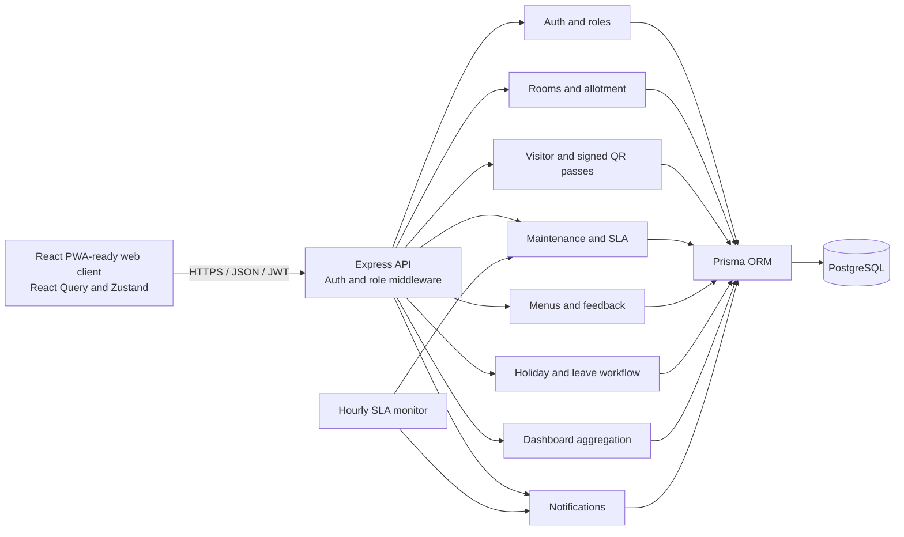

# Architecture

## Overview

The application is a modular monolith: one Express API and one PostgreSQL database, with domain modules grouped under `backend/src/modules`. The React client calls the API through a shared Axios client. Prisma is the database access layer.

## Module responsibilities

| Module | Responsibility |
|---|---|
| Auth | Login, registration, current-user lookup, logout, password change, JWT and role middleware |
| Student | Profiles, search, room assignment and unassignment |
| Room | CRUD, occupancy statistics and preference scoring |
| Visitor | Walk-in logs, 8-hour signed pass creation, scan/check-in, exit/check-out |
| Maintenance | Ticket creation, ownership, lifecycle, statistics and breach listing |
| SLA monitor | Periodically finds open tickets older than configured 48-hour threshold and notifies staff |
| Mess | Weekly menu, ratings, feedback lists and weekly trend aggregation |
| Holiday | Calendar plus leave request, approval and return confirmation |
| Dashboard | Read-only aggregation across domains for admin/warden views |
| Notification | User notices and role-targeted broadcasts |

## Room allotment

The recommendation service evaluates rooms with remaining capacity and excludes maintenance rooms. It scores preferred floor (+30), preferred room type (+20), same-course roommate (+15), and each remaining bed (+10). Recommendations are sorted by descending score and limited to five. Assignment separately checks capacity and updates room/student records transactionally.

## Visitor flow

1. Warden/admin submits the student, visitor, contact, relation, and purpose.
2. API persists a pass record and returns a QR data URL plus JWT signed with the server secret and expiring after eight hours.
3. Gate UI decodes the QR using `BarcodeDetector` or `jsQR` and submits it to the API; pasted token text is also supported.
4. API verifies signature/expiry, finds the matching stored pass, and atomically claims it once by setting `inTime`.
5. Warden/admin records exit, which sets `outTime` only for a checked-in visitor.

## Data refresh

The room map loads compact room summaries, then requests occupants only for the room the warden opens. Its assignment selector requests only unassigned students. This avoids transferring every roommate and every student for an occupancy overview. React Query mutations invalidate dependent keys so room/student changes refresh maps and dashboards, and visitor scans refresh visitor/dashboard counts. Dashboards also poll on a short interval.

## Security boundaries

The API uses Helmet, CORS allowlisting, JSON parsing, JWT authentication, role checks, validators, bcrypt password hashing, and Prisma parameterized queries. Production deployment must use HTTPS, strong secrets, least-privilege database credentials, backups, and restricted CORS origins. The browser's offline token paste is not offline authorization: signature verification and logging still require the API.
