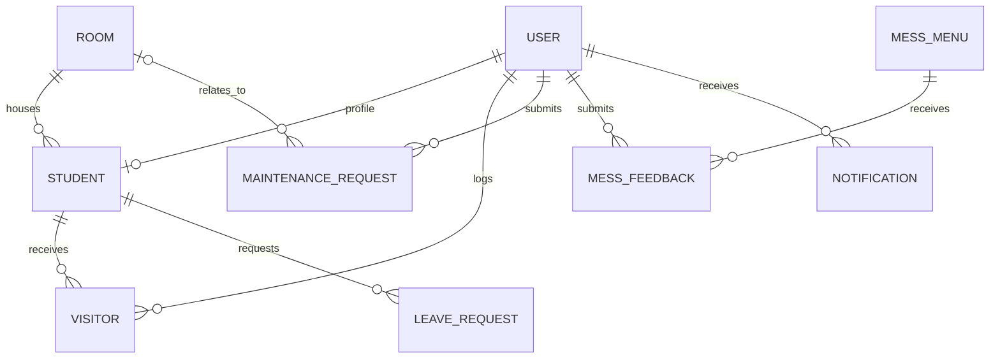

# Database Schema

PostgreSQL is the system of record. Prisma schema source: `backend/prisma/schema.prisma`; migrations: `backend/prisma/migrations/`.

## Entity relationships

## Tables and important fields

| Model/table | Main fields | Relationships and notes |
|---|---|---|
| `User` / `users` | id, name, email, password hash, role | Optional one-to-one student profile; notifications, maintenance and visitor logs |
| `Student` / `students` | rollNo, course, year, contact, admissionDate | Unique user; optional room; visitor and leave records |
| `Room` / `rooms` | roomNo, floor, type, capacity, occupancy, status, amenities | Unique room number; assigned students and maintenance requests |
| `Visitor` / `visitors` | name, phone, relation, purpose, qrToken, expiresAt, inTime, outTime | Belongs to student; optional logging staff; null `inTime` represents an issued but unused QR pass |
| `LeaveRequest` / `leave_requests` | reason, fromDate, toDate, status, returnConfirmed | Belongs to student |
| `MaintenanceRequest` / `maintenance_requests` | title, description, category, status, priority, timestamps, remarks | Belongs to user; optional room; unresolved states count toward SLA |
| `MessMenu` / `mess_menus` | day, mealType, items, description | Unique day + meal slot; feedback records |
| `MessFeedback` / `mess_feedbacks` | rating, comment, date | Belongs to user and menu item |
| `Holiday` / `holidays` | title, description, date, type | Hostel calendar |
| `Notification` / `notifications` | title, message, type, isRead, targetRole | Belongs to recipient user |

## Enums

- `Role`: `ADMIN`, `WARDEN`, `STUDENT`.
- `RoomType`: `SINGLE`, `DOUBLE`, `TRIPLE`, `QUAD`, `QUINT`.
- `RoomStatus`: `AVAILABLE`, `OCCUPIED`, `FULL`, `MAINTENANCE`.
- Maintenance status, priority, category; meal type; weekdays; holiday and notification types are defined in the Prisma schema.

## Integrity and migrations

Foreign keys and Prisma relations define deletion behavior. Room assignment is transactional and uses an occupancy capacity condition. `Room.occupancy` is a maintained counter and must match assigned student relations; dashboard values depend on it. The October 2026 room-type migration adds `QUAD` and `QUINT` to existing PostgreSQL enum types. Apply committed migrations before seeding or running a deployment.

## Demo data

The seeder creates 10 floors × 10 rooms (100), 200 student profiles, and representative operational records. It marks 10 rooms reserved and 5 rooms for maintenance, with 360 assignable beds. Seeding deletes existing student and transactional records and is intended only for a disposable development database.
